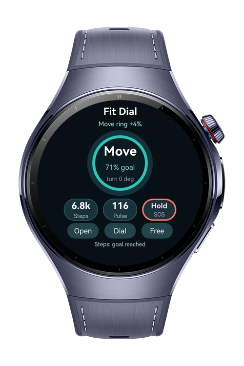
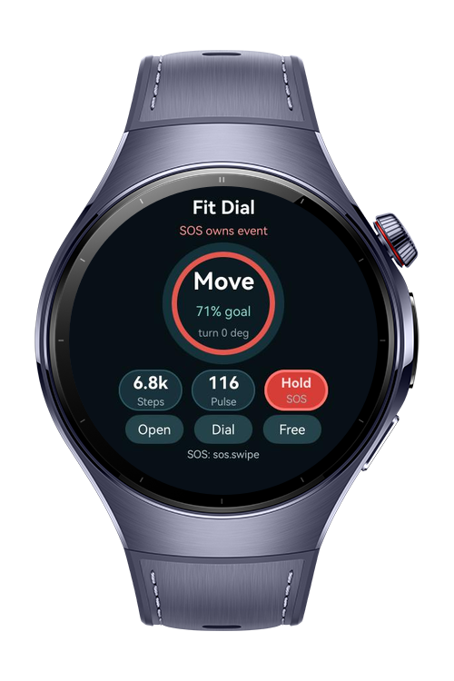
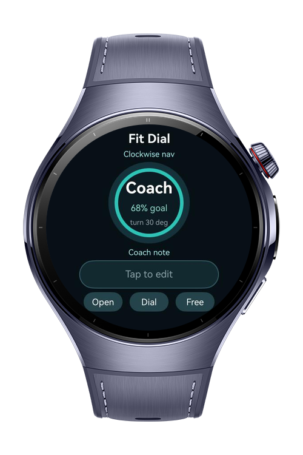

> **Note:** To access all shared projects, get information about environment setup, and view other guides, please visit [Explore-In-HMOS-Wearable Index](https://github.com/Explore-In-HMOS-Wearable/hmos-index).

# How to Build Custom Event Gesture

Fit Dial is a compact HarmonyOS wearable demo for a round-screen fitness tracker. It uses ArkTS and ArkUI common event callbacks, event monopolization, custom event dispatch, custom event interception, gesture blocking enhancement, bound gesture configuration, custom gesture judgment, and `KeyboardAvoidMode.RESIZE_WITH_CARET` for the Coach note field.

# Preview

<div>
  
  
  
</div>

# Use Cases

- Handle tap, touch, and input callbacks from a compact watch UI
- Bind tap, long-press, pan, and rotation gestures to round-screen controls
- Give emergency SOS gestures exclusive control over the current event flow
- Intercept guarded gestures before child components process them
- Resolve conflicts between circular dial navigation and nested child gestures
- Judge custom circular gestures for rotating between wearable fitness sections
- Keep the Coach note field usable when keyboard avoidance is enabled

# Technology

## Stack

- **Languages**: ArkTS, ArkUI
- **Frameworks**: HarmonyOS SDK 6.1.1
- **Tools**: DevEco Studio
- **Libraries and APIs**:
  - Common Event Callbacks: `onClick`, `onTouch`, `onChange`
  - Event Monopolization: `monopolizeEvents`
  - Custom Event Dispatch: `onChildTouchTest`, `TouchResult`, `TouchTestStrategy`
  - Custom Event Interception: `onTouchIntercept`, `HitTestMode`
  - Gesture Blocking Enhancement: `onGestureRecognizerJudgeBegin`, `shouldBuiltInRecognizerParallelWith`, `GestureJudgeResult`
  - Bound Gesture Configuration: `gesture`, `parallelGesture`, `GestureGroup`, `GestureMask`
  - Custom Gesture Judgment: `onGestureJudgeBegin`
  - ArkUI `KeyboardAvoidMode.RESIZE_WITH_CARET`

# Directory Structure

```
entry/
|-- src/
|   |-- main/
|   |   |-- module.json5
|   |   `-- ets/
|   |       |-- entryability/
|   |       |   `-- EntryAbility.ets
|   |       |-- entrybackupability/
|   |       |   `-- EntryBackupAbility.ets
|   |       `-- pages/
|   |           `-- Index.ets
```

# Constraints and Restrictions

## Supported Device

* Huawei Watch 5
* HarmonyOS wearable emulator

# License

**How to Build Custom Event Gesture** is distributed under the terms of the MIT License. See the [LICENSE](LICENSE) for more information.
